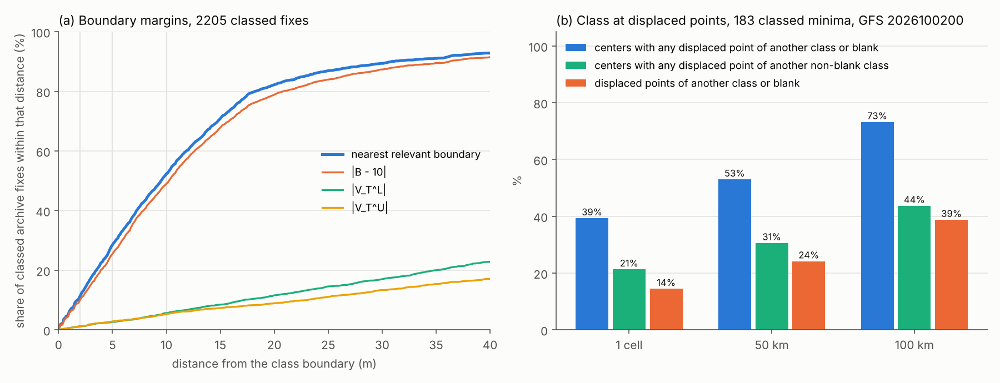

# Sensitivity of the class to boundaries, center position and detector

Code version: `05a681c` (git rev-parse --short HEAD). Written by `sensitivity.py`. Archive: `data/` (187 tracks, 3124 fixes, 2205 with a class). Frames: GFS 2026100200 at F096, F138, F168 (global 0.25 degree grid, Hart's levels, compute_products as in collect_daily).

## 1. Boundary margins in the archive

Per fix: |B - 10 m| (hb, the product's steering-proxy B), |V_T^L| and |V_T^U| (hvtl, hvtu, m), and the margin to the nearest boundary that can change the fix's class (B does not enter code 6). Fixes with a class (class at the nearest grid point of the center).

| Distance | Fixes | within 2 m | within 5 m | within 10 m | median (m) |
|---|---|---|---|---|---|
| nearest relevant boundary | 2205 | 11% | 28% | 52% | 9.5 |
| B from 10 m | 2205 | 10% | 26% | 49% | 10.1 |
| V_T^L from 0 | 2205 | 1% | 2% | 5% | 85.8 |
| V_T^U from 0 | 2205 | 0% | 2% | 3% | 142.0 |

Per class (nearest relevant boundary; the B, V_T^L and V_T^U columns give the share within 5 m of each line):

| Class | Fixes | within 2 m | within 5 m | within 10 m | median (m) | B within 5 m | V_T^L within 5 m | V_T^U within 5 m |
|---|---|---|---|---|---|---|---|---|
| 0 sym deep warm | 737 | 6% | 22% | 54% | 9.4 | 20% | 0% | 2% |
| 1 sym shallow warm | 481 | 12% | 35% | 68% | 7.1 | 31% | 3% | 2% |
| 2 asym deep warm | 173 | 27% | 53% | 70% | 4.2 | 50% | 0% | 3% |
| 3 asym shallow warm | 396 | 12% | 28% | 41% | 13.3 | 27% | 1% | 1% |
| 4 asym cold | 306 | 8% | 15% | 23% | 23.2 | 11% | 4% | 0% |
| 5 sym cold | 56 | 39% | 71% | 98% | 2.5 | 50% | 25% | 4% |
| 6 shallow cold | 56 | 0% | 2% | 9% | 44.7 | 18% | 0% | 2% |

Flicker: of 1904 6 h steps with a class at both ends, the class changes at 393 (21%); 73 of those changes (19% of changes, 3.8% of steps) are back to the previous class within 12 h (43 after a single 6 h fix, the rest after two). Steps into or out of a blank class (no closed low, B blank) are not counted.

## 2. Class change under a center displacement

Each center's class (grid point) against the eight grid points one cell (0.25 degree, about 28 km north-south) away and the four points 50 km and 100 km away along the axes (class at the nearest grid point, values bilinear). A blank point (outside the class blob, below ground or B blank) counts as a different class; the column "another non-blank class" counts only a real change of class. Centers: first the tracker's candidate minima that have a class (`all_centers`: terrain masked, under 1018 hPa, within 85 degrees of the equator); then the exporter's, one per connected class blob at its MSLP minimum. The exporter's set includes blob fragments cut by below-ground blanking (Antarctica, the Andes, the Tibetan plateau, the Rockies), whose MSLP minimum lies on the edge of the fragment, so its blank counts are high; the first set is the one that describes tracked lows.

**Tracker candidates with a class**: 183 (F096 61, F138 56, F168 66).

| Displacement | Centers with any point of another class | Centers with any point of another non-blank class | Points of another class | of them blank | Centers where most points differ | median abs change B / V_T^L / V_T^U (m) | 90th percentile (m) |
|---|---|---|---|---|---|---|---|
| 1 cell | 39% (72/183) | 21% (39/183) | 14% (212/1464) | 119 | 5% (9/183) | 1.0 / 5.7 / 3.6 | 3.6 / 23.4 / 12.1 |
| 50 km | 53% (97/183) | 31% (56/183) | 24% (177/732) | 93 | 9% (17/183) | 1.9 / 11.6 / 6.4 | 6.5 / 40.4 / 21.4 |
| 100 km | 73% (134/183) | 44% (80/183) | 39% (284/732) | 153 | 24% (44/183) | 4.0 / 22.0 / 12.6 | 13.0 / 72.6 / 38.9 |

**Exporter centers**: 163 (F096 49, F138 53, F168 61).

| Displacement | Centers with any point of another class | Centers with any point of another non-blank class | Points of another class | of them blank | Centers where most points differ | median abs change B / V_T^L / V_T^U (m) | 90th percentile (m) |
|---|---|---|---|---|---|---|---|
| 1 cell | 53% (86/163) | 20% (32/163) | 27% (354/1304) | 284 | 18% (29/163) | 0.9 / 5.4 / 3.1 | 3.4 / 22.7 / 11.7 |
| 50 km | 64% (104/163) | 28% (46/163) | 38% (246/652) | 179 | 26% (43/163) | 1.7 / 10.0 / 5.7 | 6.0 / 40.2 / 19.2 |
| 100 km | 77% (125/163) | 41% (67/163) | 49% (319/652) | 214 | 37% (61/163) | 3.7 / 19.5 / 10.8 | 11.8 / 73.0 / 38.2 |

## 3. Detector selection

Candidate minima: every point `track_cps.all_centers` accepts (lowest of its +/- 1 degree box after terrain is masked, MSLP under 1018 hPa, within 85 degrees of the equator), both hemispheres, summed over the three frames (F096 834, F138 820, F168 854). Closed 2 hPa: inside `closed_low_mask` with a 2 hPa ring (the tracker's `closed_mask`) at the minimum itself; in brackets the tracker's own test (`closed_at`, the mask at the deepest MSLP within 300 km). Closed 5 hPa: inside the product's mask (`closed_low_mask` with depth 5 hPa, as `executeHartClass` calls it). Class: HCPSclass finite at the minimum (also needs B and the band levels).

| Bin | Minima | Closed 2 hPa (closed_at) | Closed 5 hPa | With a class |
|---|---|---|---|---|
| all | 2508 | 27% (679/2508) (34% (850/2508)) | 9% (228/2508) | 7% (183/2508) |
| MSLP (hPa) below 980 | 161 | 62% (100/161) (64% (103/161)) | 55% (89/161) | 44% (71/161) |
| MSLP (hPa) 980 to 1000 | 209 | 51% (107/209) (61% (128/209)) | 36% (75/209) | 26% (54/209) |
| MSLP (hPa) above 1000 | 2138 | 22% (472/2138) (29% (619/2138)) | 3% (64/2138) | 3% (58/2138) |
| latitude 0 to 25 | 1493 | 15% (218/1493) (20% (303/1493)) | 1% (19/1493) | 1% (17/1493) |
| latitude 25 to 60 | 501 | 53% (264/501) (61% (307/501)) | 17% (86/501) | 16% (82/501) |
| latitude 60 to 85 | 514 | 38% (197/514) (47% (240/514)) | 24% (123/514) | 16% (84/514) |

Central pressure by latitude band (minima, then the share with a class):

| Latitude | below 980 hPa | 980 to 1000 hPa | above 1000 hPa |
|---|---|---|---|
| 0 to 25 | 2, 100% (2/2) | 9, 78% (7/9) | 1482, 1% (8/1482) |
| 25 to 60 | 24, 88% (21/24) | 45, 56% (25/45) | 432, 8% (36/432) |
| 60 to 85 | 135, 36% (48/135) | 155, 14% (22/155) | 224, 6% (14/224) |

